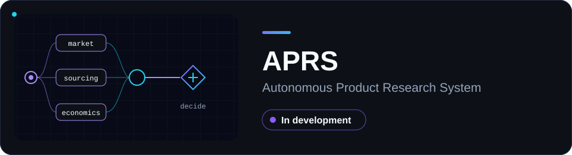
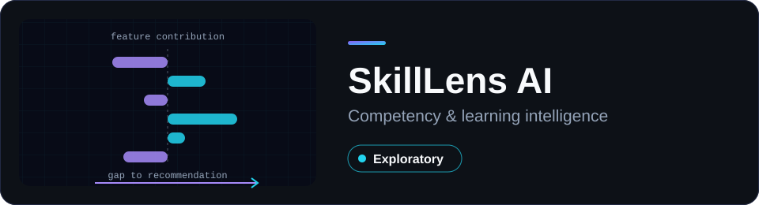
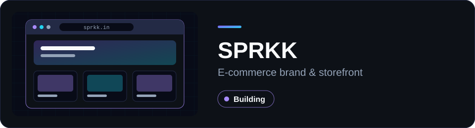
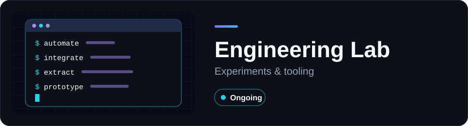
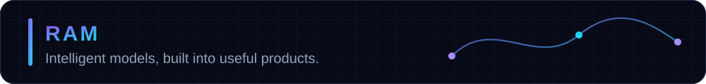

  

  
  
  
  

  Architecting intelligent systems, agentic AI workflows, product intelligence platforms, and scalable web applications.

## About

I build software that connects intelligent models with useful products. My interests include multi-agent AI systems, product intelligence, explainable machine learning, automated web research, e-commerce engineering, and full-stack application development.

<table>
<tr>
<td width="50%" valign="top">

**Current focus**

- APRS: Autonomous Product Research System
- SPRKK: e-commerce brand and storefront
- Agentic AI and multi-agent workflows
- Explainable ML
- Full-stack engineering
- Automated research and data pipelines

</td>
<td width="50%" valign="top">

**Engineering approach**

- Evidence before assumptions
- Products that solve a real problem
- Models that can explain themselves
- Systems that fail loudly and recover cleanly
- Learning by building, one project at a time

</td>
</tr>
</table>

Areas of interest

 

Multi-agent AI systems, product intelligence, explainable machine learning, automated web research, e-commerce engineering, and full-stack application development.

Contact

 

- Email: [ramm205061@gmail.com](mailto:ramm205061@gmail.com)
- Website: [sprkk.in](https://sprkk.in/)
- Instagram: [@_raamm1](https://instagram.com/_raamm1)

## Featured projects

### APRS

**Problem.** Finding a product worth selling means stitching together market data, trend signals, supplier research and cost maths by hand.

**What it is.** An AI-assisted product research platform designed to identify potential e-commerce opportunities and evaluate them through market intelligence, product signals, sourcing research, and economic analysis. It is built around multi-agent research workflows, product discovery, marketplace intelligence, trend analysis, supplier research, product economics, and decision support.

       

**Status.** In development. Architecture and data sources are not published here.

### SkillLens AI

**Problem.** Learning data rarely becomes something a learner or teacher can act on, and model outputs are hard to trust without an explanation.

**What it is.** An AI-assisted competency and learning intelligence platform exploring how learning evidence can be turned into competency insights, skill-gap analysis, and understandable recommendations. It uses SHAP-based feature explanations, LLM-assisted quiz generation, and an API-backed application architecture.

      

**Status.** Exploratory.

### SPRKK

**Problem.** A new brand needs a storefront that feels considered and is grounded in real product and market research.

**What it is.** An e-commerce brand and digital storefront that I am building: Shopify storefront development, theme customization, storefront experience, e-commerce workflows, and product and market research.

    

**Status.** Building. Visit [sprkk.in](https://sprkk.in/).

### Engineering Lab

Smaller experiments in automation, API integrations, data processing, browser automation, AI, and developer tools. Public work lives in my [repositories](https://github.com/raa-mm?tab=repositories).

## Technology stack

| Area | Technologies |
| :-- | :-- |
| Languages |    |
| Frontend |    |
| Backend |  |
| AI and ML |     |
| Databases |  |
| Automation |  |
| Infrastructure |  |
| E-commerce |   |

## GitHub analytics

  
  

  

These cards come from third-party services and can be rate-limited or briefly unavailable.

## Contribution activity

  

  <picture>
    <source media="(prefers-color-scheme: dark)" srcset="https://raw.githubusercontent.com/raa-mm/raa-mm/output/github-snake-dark.svg">
    <source media="(prefers-color-scheme: light)" srcset="https://raw.githubusercontent.com/raa-mm/raa-mm/output/github-snake.svg">
    
  </picture>

Both graphics are generated from real contribution data by GitHub Actions in this repository.

## Engineering philosophy

- **Evidence over assumptions.** A recommendation is only as good as the data behind it, so I build pipelines that keep their sources visible.
- **Useful before impressive.** The measure of a system is whether someone can act on what it produces.
- **Explainable by default.** If a model suggests something, the reasons should be inspectable.
- **Reliable systems.** Validate inputs, automate checks, and make failures obvious.
- **Keep learning.** Each project should leave me able to build the next one better.

 

  <a href="mailto:ramm205061@gmail.com">Email</a> ·
  <a href="https://sprkk.in/">Website</a> ·
  <a href="https://github.com/raa-mm">GitHub</a> ·
  <a href="https://instagram.com/_raamm1">Instagram</a>

